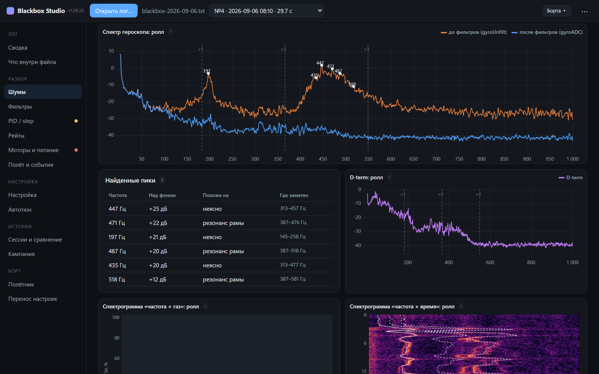

<p align="center">
  
</p>

<h1 align="center">Blackbox Studio</h1>

<p align="center">
  Разбор и настройка FPV-квадрокоптера по блэкбоксу Betaflight.<br>
  Открыл лог — получил понятный ответ: что не так, что крутить и чем за это платишь.
</p>

<p align="center">
  <a href="https://github.com/mjsvyat/blackbox-studio/releases/latest"><b>⬇ Скачать для Windows</b></a>
  &nbsp;·&nbsp;
  <a href="docs/Blackbox-Studio-instrukciya.pdf"><b>📄 Инструкция (PDF)</b></a>
  &nbsp;·&nbsp;
  <a href="CHANGELOG.md">Что нового</a>
</p>

<p align="center">
  <a href="https://github.com/mjsvyat/blackbox-studio/actions/workflows/ci.yml"></a>
  <a href="https://github.com/mjsvyat/blackbox-studio/releases/latest"></a>
  
  
</p>


Зачем: летать больше, а думать о настройке меньше. Вместо часов в PIDtoolbox и Blackbox Explorer —
светофор по шумам, фильтрам, PID, моторам и питанию и советы с готовыми строками CLI. Правила
собраны по разборам логов экспертами чата Blackbox 2.0.

Работает **без интернета**: ни сервера, ни аккаунтов, ни телеметрии. Логи остаются на компьютере.

## Скачать

Страница [**Releases**](https://github.com/mjsvyat/blackbox-studio/releases/latest):

| Файл | Что это |
|------|---------|
| `BlackboxStudio-Setup-….exe` | Установщик для Windows 10/11 — **рекомендуется** |
| `BlackboxStudio-Portable-….exe` | Без установки, можно с флешки |
| `BlackboxStudio-…-web.html` | Тот же интерфейс в Chrome/Edge — для macOS и Linux |

> Если Windows пишет «Система Windows защитила ваш компьютер» — нажми **«Подробнее» →
> «Выполнить в любом случае»**. Так Windows встречает новые программы, пока у них нет «репутации».

## Что умеет

| | |
|:-:|:-:|
|  |  |
| **Шумы** — спектры до и после фильтров, пики с природой (моторы / рама), спектрограммы | **Фильтры** — точная модель цепочки Betaflight и примерка: подвигал ползунок — увидел задержку и шум на этом же полёте |
|  |  |
| **PID / step response** по движениям стиков, прогноз «что будет, если…» | **Советы** — сначала механика, потом не больше двух изменений за полёт, готовый CLI |

- **Любой лог**: `.bbl`, `.bfl`, `.txt` и полный дамп флешки; битые куски и дубли находит сам.
- **Автотюн**: разобрал → записал на борт по USB → слетал → разобрал снова. Неудачное изменение откатывает.
- **Рейты**: формулы Betaflight один в один и примерка кривой на твоих стиках.
- **Моторы и питание**: насыщение, десинки, разброс моторов, просадка, сопротивление пакета.
- **Полётник по USB**: скачать и стереть флешку, подготовить запись лога, записать совет с бэкапом и откатом.
  Пишет только по кнопке, только на незаармленный борт и только от USB, без аккумулятора.
- **История**: сессии «было → прогноз → стало», кампании настройки, журнал инцидентов, несколько бортов.
- **Перенос настроек** между версиями Betaflight и **видео из очков** рядом с графиками.

## Как пользоваться

1. **«Открыть лог…»** или перетащи файл в окно; выбери лог из списка.
2. **«Сводка»** — что красное и жёлтое. У каждой цифры есть **«?»** с объяснением.
3. **«Настройка»** — советы и строки CLI. Или сразу **«Автотюн»**.
4. Примени совет, слетай так же, открой новый лог и сравни в **«Сессии и сравнение»**.

Хороший лог для разбора: частота записи 1.6–2 кГц, гироскоп до фильтров, газ до 100 %, резкие
движения по каждой оси. Проще всего — вкладка **«Полётник» → «Подготовить запись лога»**.

Подробно — в [инструкции (PDF)](docs/Blackbox-Studio-instrukciya.pdf).

## Помочь проекту

Нужны реальные полёты: тестируй, а в конце серии пришли **экспорт кампании** (вкладка
«Кампания» → «Экспорт кампании») на **mjsvyat@gmail.com**. По этим файлам видно, какие
советы помогают, а какие нет, — так утилита становится точнее. Что и как присылать — в
[инструкции](docs/Blackbox-Studio-instrukciya.pdf); ошибки и идеи — в [Issues](https://github.com/mjsvyat/blackbox-studio/issues).

## Прошивки

Betaflight **4.3 … 2026.6** (проверено на 4.5.2 и 2026.6.1). Для логов до 4.5 гироскоп до
фильтров берётся из `debug_mode = GYRO_SCALED`. INAV, EmuFlight и Rotorflight не поддерживаются.

## Где хранятся данные

Сессии, кампании, борта и инциденты — в `%APPDATA%\Blackbox Studio` (меню «Справка → Папка с
данными программы»). При удалении программы они не удаляются.

## Подпись кода и приватность

Пока exe без цифровой подписи. Бесплатную подпись для open source даёт [SignPath Foundation](https://signpath.org),
но только проектам, которые уже заметны в сообществе (звёзды, форки, обсуждения). Первую заявку
отклонили как раз поэтому — проект новый. Поставь ⭐ репозиторию и расскажи о нём: когда проект
наберёт известность, подадим заявку снова. Подпись делается в GitHub
Actions из исходников этого репозитория (`.github/workflows/release.yml`), подробно —
[`docs/SIGNING.md`](docs/SIGNING.md).

- Авторы, ревьюеры и утверждающие релизы: [@mjsvyat](https://github.com/mjsvyat).
- Программа не передаёт никаких данных по сети, кроме случаев, когда пользователь сам об этом
  просит. Логи, настройки и сессии остаются на компьютере.

## Лицензия

[MIT](LICENSE).

## Для разработчиков

```bash
npm install          # один раз
npm run dev          # http://localhost:5181
npm test             # тесты; на настоящих логах — если они лежат в tests/fixtures/
npm run build        # dist/index.html — один файл
npm run app:win      # установщик и portable → desktop/release
```

Устройство проекта — [`docs/dev/PLAN.md`](docs/dev/PLAN.md), правила работы с кодом и порогами —
[`CLAUDE.md`](CLAUDE.md), подпись exe — [`docs/SIGNING.md`](docs/SIGNING.md). Пороги светофора —
`src/config/analysis.json`, тексты интерфейса — `src/i18n/ru.ts`, подсказки — `src/content/help/`.

Выпуск версии: поднять версию в `package.json` и `desktop/package.json`, добавить раздел в
`CHANGELOG.md`, после слияния — **Actions → Release → Run workflow**.
