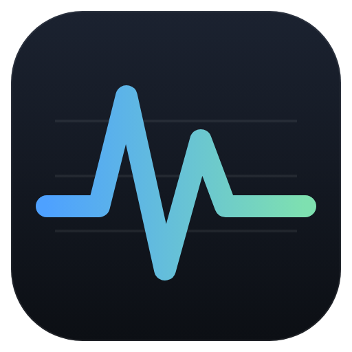
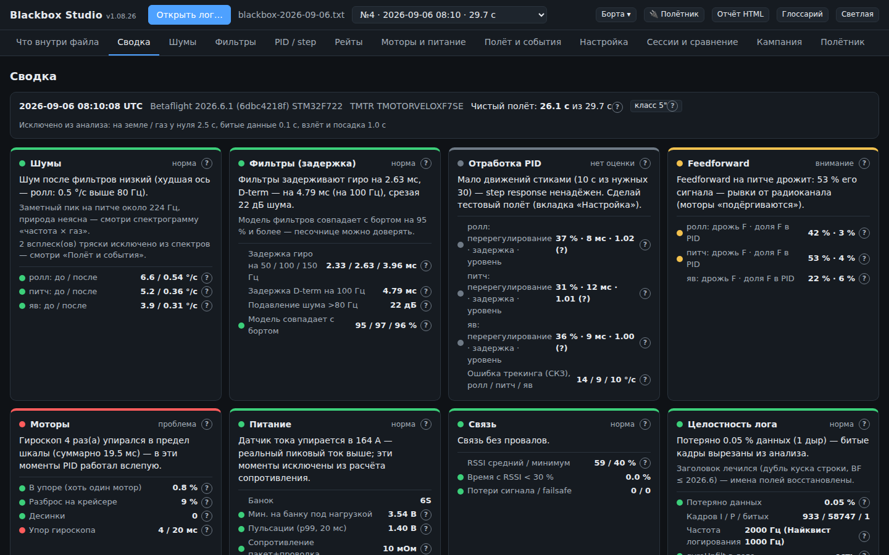
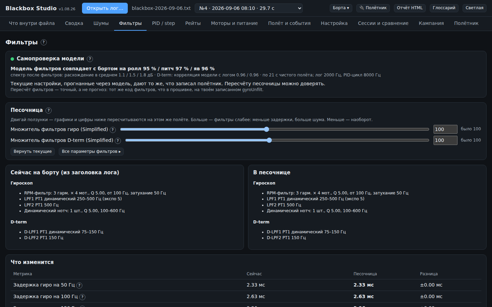
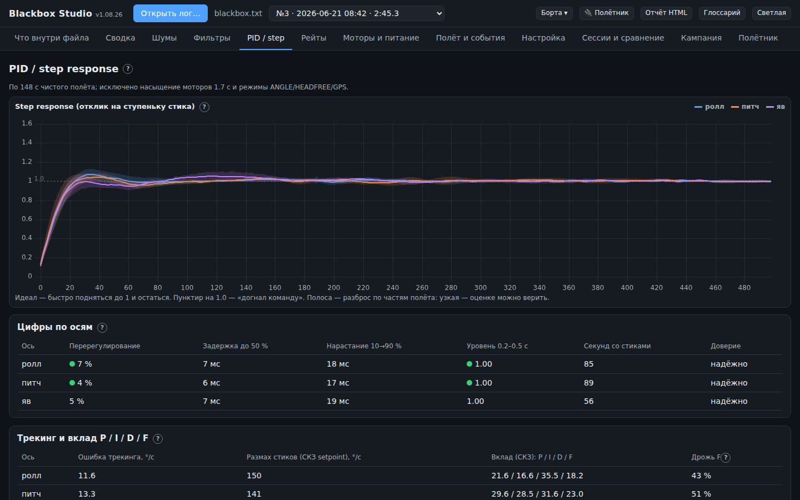
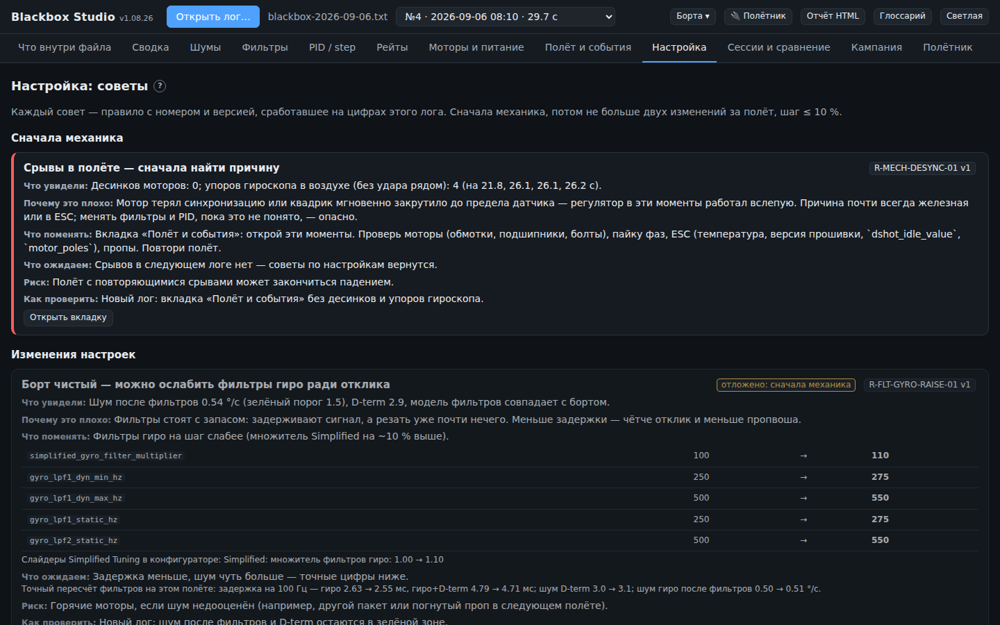
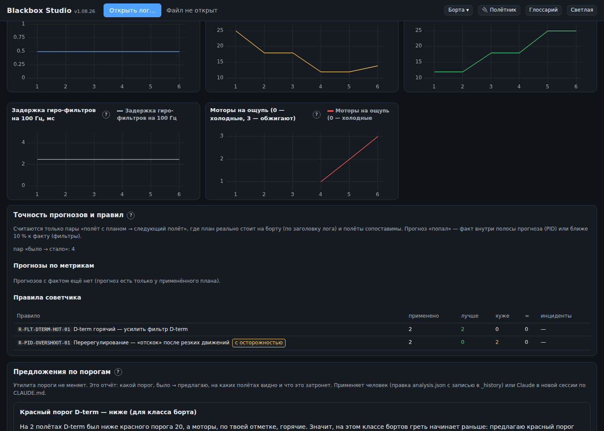
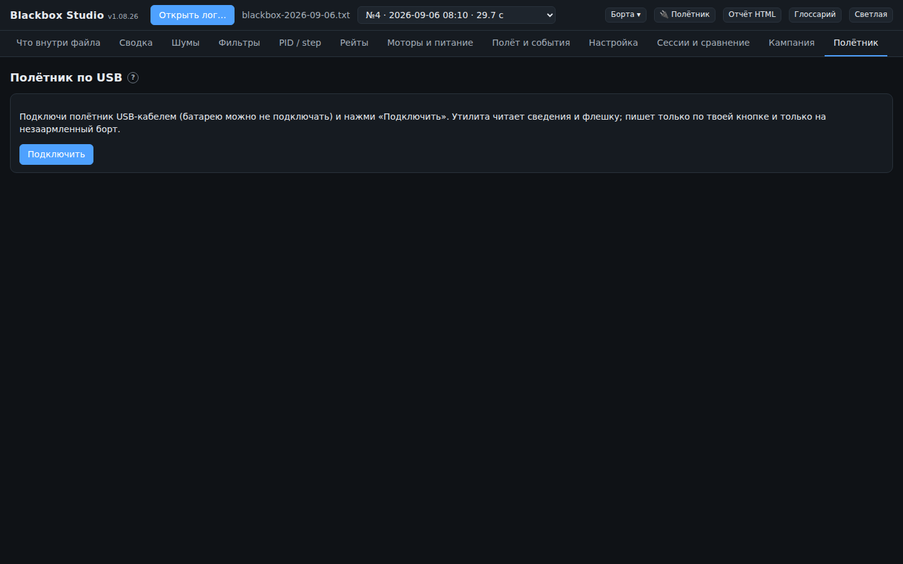

<p align="center">
  
</p>

<h1 align="center">Blackbox Studio</h1>

<p align="center">
  Разбор и настройка FPV-квадрокоптера по блэкбоксу Betaflight.<br>
  Шумы, фильтры, PID, рейты, моторы — понятным языком, с советом «что крутить и чем платим».
</p>

<p align="center">
  <a href="https://github.com/mjsvyat/blackbox-studio/releases/latest"><b>⬇ Скачать для Windows</b></a>
  ·
  <a href="CHANGELOG.md">Что нового</a>
  ·
  <a href="#как-пользоваться">Как пользоваться</a>
</p>

<p align="center">
  <a href="https://github.com/mjsvyat/blackbox-studio/actions/workflows/ci.yml"></a>
  <a href="https://github.com/mjsvyat/blackbox-studio/actions/workflows/release.yml"></a>
</p>



Работает **без интернета**: ни сервера, ни аккаунтов, ни телеметрии. Логи и настройки остаются
на компьютере.

## Скачать

Последняя версия — на странице [**Releases**](https://github.com/mjsvyat/blackbox-studio/releases/latest).

| Файл | Что это |
|------|---------|
| `BlackboxStudio-Setup-v1.08.26.exe` | Установщик: ярлык на рабочем столе и в «Пуске», удаление через «Приложения». **Рекомендуется.** |
| `BlackboxStudio-Portable-v1.08.26.exe` | Без установки: один файл, можно запускать с флешки. |
| `BlackboxStudio-v1.08.26-web.html` | Тот же интерфейс одним файлом для Chrome/Edge — открыть двойным кликом (Windows, macOS, Linux). |
| `SHA256SUMS.txt` | Контрольные суммы файлов. |

Нужна Windows 10 или 11 (64 бит).

> **Windows SmartScreen** может предупредить «Система Windows защитила ваш компьютер»: программа
> пока без цифровой подписи. Нажми **«Подробнее» → «Выполнить в любом случае»**. Проверить, что файл
> не подменён, можно по `SHA256SUMS.txt`: `certutil -hashfile BlackboxStudio-Setup-v1.08.26.exe SHA256`.

## Что умеет

**Разбор лога**
- Открывает `.bbl`, `.bfl`, `.txt` и **полный дамп флешки** (сотни МБ). Битые куски, заворот флешки
  W25N01GV на 64 МиБ и дубли логов находит сам и честно говорит, что выкинуто.
- **Сводка-светофор**: шумы, задержка фильтров, отработка PID, feedforward, моторы, питание.
  У каждой цифры — кнопка **«?»**: что это, почему плохо, что крутить, чем платим.
- **Шумы**: спектры до и после фильтров, спектрограмма «частота × газ», D-term. Удары и срывы
  из спектров исключаются, чтобы один кувырок не «перекрашивал» весь полёт.
- **Фильтры**: точная модель цепочки фильтров Betaflight (самопроверка по логу ≥ 90 %), песочница —
  двигай Simplified-ползунки и сразу видишь задержку и шум на этом же полёте.
- **PID / step response** по реальным движениям стиков, модель оси и прогноз «что будет, если
  поднять D» — всегда с полосой разброса и пометкой «модель, проверь полётом».
- **Рейты**: формулы Betaflight один в один, «на этом флипе крутился бы 1000 °/с вместо 800».
- **Моторы и питание**: насыщение, десинки, разброс моторов, просадка банок, сопротивление пакета.
- **Полёт и события**: срывы, упоры гироскопа, удары — с переходом к моменту на графике.
- **Частотный анализ**: АЧХ, когерентность, запасы устойчивости; модель по chirp-полёту
  (если прошивка собрана с `USE_CHIRP`).

**Настройка**
- **Советчик**: каждый совет — правило с номером и версией, сработавшее на цифрах этого лога.
  Сначала механика, потом не больше двух изменений за полёт. Готовые строки CLI.
- **Сессии и сравнение «было → прогноз → стало»**: проверяет по заголовку лога, что план реально
  применён, и не выдаёт «лучше/хуже», если полёты несравнимы (висение против фристайла, разный газ).
- **Кампания настройки**: серия полётов с целью, протокол тестового полёта, отметки «моторы на
  ощупь», точность прогнозов и правил, предложения порогов. Экспорт кампании одним файлом.
- **Инциденты**: «стало хуже» → папка случая для разбора; правило, дважды ухудшившее результат на
  борту, само становится «с осторожностью».
- **Несколько бортов**: борт определяется по ID полётника; классы 65 мм … 10" со своими порогами;
  перенос настроек между бортами.

**Полётник по USB**
- Сводка флешки, **скачивание блэкбокса** и **стирание** прямо из программы.
- Чтение настроек (`diff all` / `dump all`) и **запись совета на борт** с бэкапом и **откатом**.
- Пишет только по нажатию и только на **незаармленный** борт; команд, способных крутить моторы, в
  программе нет.

**Видео из очков**: MOV/MP4 рядом с графиками, синхронизация по часам и по движению кадра.

| Фильтры | PID / step response |
|:-:|:-:|
|  |  |
| **Советы** | **Кампания настройки** |
|  |  |

## Как пользоваться

1. **Открой лог** кнопкой «Открыть лог…» или перетащи файл в окно. Можно сразу весь дамп флешки —
   программа покажет список логов.
2. **«Сводка»** — светофор. Красное и жёлтое — смотри соседние вкладки, там причины.
3. **«Настройка»** — советы с номером правила, цифрой, риском и готовым CLI. Сначала механика.
4. **Песочницы** «Фильтры», «Рейты», «PID / step» — подвигай, посмотри, чем платишь.
5. **«Сессии и сравнение» → «Сохранить как сессию»**, примени совет (CLI или «На борт по USB…»),
   слетай, открой новый лог — увидишь «было / прогноз / стало».
6. Стало хуже — **↩ откат** настроек и **⚠ «Сообщить о проблеме»**.

Хороший тестовый полёт для разбора: 20–30 с висения, по 3 флипа по ролу и питчу, пара панчей и
сбросов газа, блэкбокс 1.6–2 кГц с `gyroUnfilt` (`set blackbox_disable_gyrounfilt = OFF`).
Вкладка «Кампания» подскажет, чего не хватило.

### Полётник по USB

Вкладка **«Полётник»** → «Подключить» → выбери порт (обычно «USB Serial Device (COMx)» или
«STM32 Virtual ComPort»). Если порта нет — нужен драйвер (Betaflight Configurator → «Установить
драйверы» или ImpulseRC Driver Fixer). Перед стиранием флешки и записью настроек — **пропеллеры
сняты**, борт не заармлен.



## Где хранятся данные

- Сессии, кампании, борта и инциденты — в папке программы: `%APPDATA%\Blackbox Studio`
  (меню «Справка → Папка с данными программы»). При удалении программы они **не удаляются**.
- Установщик и portable-версия пользуются одной папкой данных.
- Сессии из браузерной версии в программу сами не переедут: в браузере «Сессии и сравнение» →
  «Экспорт в файл», в программе — «Импорт из файла…».

## Прошивки

Проверено на логах **Betaflight 4.5.2** (1 кГц) и **2026.6.1** (2 кГц); режимы полёта и параметры
разбираются по версии прошивки из заголовка лога (4.3 … 2026.6). Логи других прошивок (INAV,
EmuFlight, Rotorflight) не поддерживаются.

## Для разработчиков

```bash
npm install            # один раз
npm run dev            # http://localhost:5181, подсказки .md подхватываются на лету
npm run build          # dist/index.html — один файл, открывается двойным кликом без сервера
npm test               # все тесты (включая дамп 132 МБ из Git LFS: сначала git lfs pull)
npm run test:fast      # без большого дампа

npm --prefix desktop install   # один раз: Electron и electron-builder
npm run app                    # программа в окне Electron (из свежей сборки)
npm run app:win                # установщик и portable → desktop/release (на Windows)
```

Устройство проекта, этапы и ограничения — [`PLAN.md`](PLAN.md); правила работы с кодом, пороги и
разбор инцидентов — [`CLAUDE.md`](CLAUDE.md); исходные ТЗ — [`docs/`](docs).

- `src/config/analysis.json` — все пороги светофора (меняются только с записью в `_history`).
- `src/content/help/*.md` — тексты подсказок «?» (три уровня: «Коротко», «Подробно», «Для тюнера»).
- `src/i18n/ru.ts` — все строки интерфейса.
- `desktop/` — Windows-программа: окно Electron вокруг того же `dist/index.html`.
- `cases/INC-xxxx-*/` — разобранные инциденты, каждый — регрессионный тест.
- `tests/fixtures/` — настоящие логи для тестов (большой дамп — Git LFS).

### Выпуск версии

1. Поднять версию в `package.json` **и** `desktop/package.json` (`version` — semver `1.8.26`,
   `releaseName` — как в релизе `1.08.26`).
2. Добавить раздел `## v1.08.26` в [`CHANGELOG.md`](CHANGELOG.md).
3. После слияния в `main`: **Actions → Release → Run workflow** (или `git tag v1.08.26 && git push
   origin v1.08.26`). Workflow соберёт установщик, portable и веб-версию на Windows и опубликует
   релиз с текстом из CHANGELOG.

CI на каждом PR проверяет типы, тесты (без большого дампа) и сборку; PR, меняющий `desktop/`,
дополнительно собирает Windows-программу — exe лежат в артефактах прогона.
